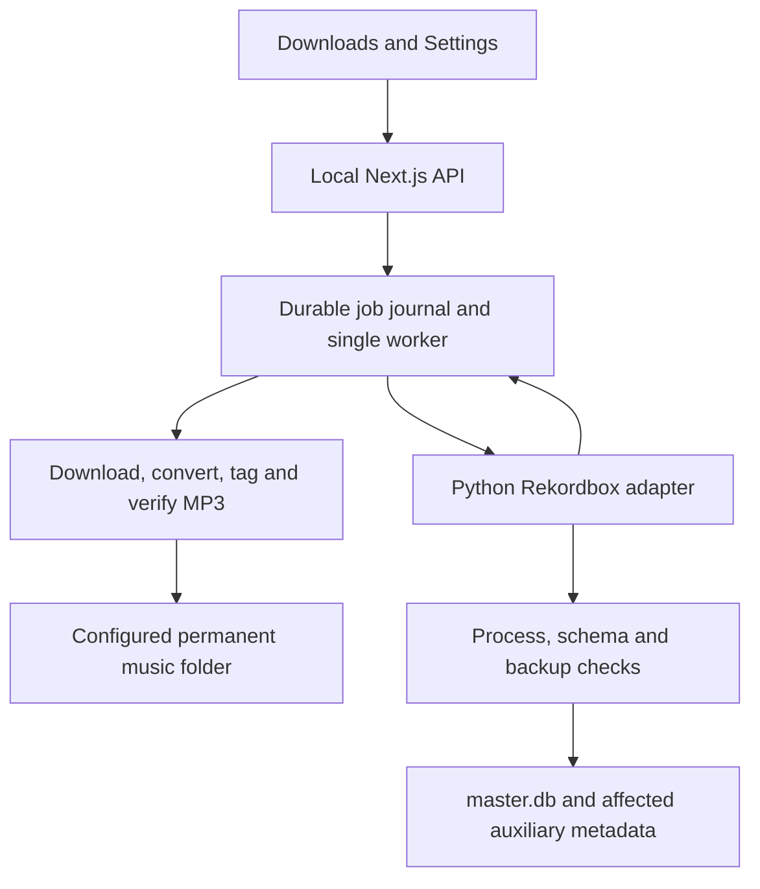

# Local MP3 downloads and automatic Rekordbox import

Status: Phases 1–7 complete for the local macOS workflow. Playback was confirmed after registration repair and verified on the automatically imported track. The APFS publication requirement and local-server requirement remain as documented below.

### Execution checkpoints

- **Phase 1:** pinned Python/SQLCipher connector, configured-library discovery, isolated import/repeat/second-playlist verification, backed-up real import and registration repair. The user confirmed playback. The corrected import clears pyrekordbox's inappropriate source flags and uses the real filesystem identifier.
- **Metadata follow-up:** Space Racer now has title `Space Racer`, artist `Shubostar` and album `Space Racer` in the MP3 ID3 tags and linked Rekordbox fields. The label's [release page](https://ujurecords.bandcamp.com/album/space-racer) verifies the album. Future jobs carry available catalog album metadata without extra Spotify requests; the download worker writes title/artist/album tags, and the importer assigns proper artist/album relationships.
- **Phase 2:** Settings includes a native folder picker, manual path, default folder, Finder reveal, durable account-scoped local preferences, writable-folder validation, library path override and connection check. Saved and checked in the browser with `~/Music/Crate Digger`; the library connected successfully. Automatic import controls remain deferred until the download/import worker is connected, avoiding a switch that cannot yet take effect.
- **Phase 3:** new jobs snapshot the saved destination and directory identity, download into private staging on that filesystem, copy audio while writing ID3 tags, verify with ffprobe, and publish a standalone MP3 without replacing existing files. A durable source-video receipt supports verified reuse. Per-track UI states, partial failures, destination display and Finder reveal replace ZIP controls. Legacy archives remain readable through their authenticated route; new jobs never create ZIPs. Permanent MP3s and their receipts are excluded from temporary-job cleanup.
- **Live verification:** Space Racer downloaded from its selected YouTube match into `~/Music/Crate Digger`, with title/artist/album verified. A repeat click showed **Already downloaded**, reused the existing verified file and created no ZIP. One focused worker integration test covered real MP3 tagging, publication, repeat reuse, collision refusal and changed-file refusal; TypeScript validation passed.
- **Current filesystem limit:** exclusive atomic publication uses hard links, verified on the Mac's APFS volume. Unsupported destinations report an actionable error; exFAT/FAT publication needs a separate no-clobber fallback before claiming support for those filesystems. Phase 6 now reconciles interrupted publication with inode/hash-backed intents; unowned or changed collisions remain untouched.
- **Phase 4:** each new download job captures its source playlist ID/name, Spotify recording IDs, destination library identity/path, and the resolved Rekordbox playlist or create intent. Mappings are stored durably per account, library ID/path and source playlist ID. Unique ordinary name matches are reused; ambiguous names, intelligent-only matches and removed targets require a destination choice with full folder paths. Saved IDs survive source/target renames. Optimistic checks prevent a stale automatic resolution from replacing a newer explicit choice.
- **Phase 4 live verification:** the read-only connector listed 99 live playlists/folders with full paths. The Downloads page resolved **DJ Nifty Oct** to a create-on-import destination; a repeat Space Racer job captured the mapping and Spotify recording ID and reused the existing MP3. The focused mapping check covers ambiguity, intelligent playlists, removed targets, rename persistence, account/library isolation and stale-save rejection. TypeScript validation passed. No Rekordbox library writes occurred in this phase.
- **Phase 5:** automatic import is connected to download completion and can be disabled in Settings. The worker waits while Rekordbox or its agent runs, takes a shared cross-process writer lock, validates saved audio/receipts and library identity, makes an encrypted consistent backup, creates or reuses ordinary playlists, and adds missing path-based content/memberships. New entries use the verified local playback flags and filesystem identifiers. Existing entries retain cues, grids and metadata. A durable journal covers database commit and the targeted auxiliary XML merge; fresh read-back precedes success. Mapping promotion preserves newer explicit destination choices. Keep five generated import backups per library, plus backups protecting unfinished import journals. Retry import reuses saved MP3s.
- **Phase 5 verification:** isolated-copy repeat imports and a second playlist reused one collection entry. An injected interruption after commit recovered its XML update on retry. The live job waited with Rekordbox open, resumed after both processes stopped, and created **DJ Nifty Oct** with **Space Racer / Shubostar / Space Racer**. The mapping was promoted to the actual playlist ID; independent read-back confirmed local playback flags and one membership. A full repeat download/import reused the MP3 and retained one collection row, playlist and membership. Reopening Rekordbox showed the new playlist; its track loaded onto deck 1 and playback advanced before being paused. Rekordbox itself generated the displayed waveform/BPM/key analysis.
- **Phase 6:** Next.js startup instrumentation scans unfinished local jobs and repeats every 30 seconds. OS locks serialize account actions, destination mappings and one worker per job across server restarts; recovery never replaces a running worker. Repeated worker exits pause after three recovery launches in five minutes. Workers back off from 15 seconds to two minutes for Rekordbox, writer locks and missing original drives. Stop is durable and cooperative: finish the current file or commit/XML reconciliation, keep saved work, and do not resume cancelled jobs automatically. Resume reuses verified files and the original folder/library snapshot; a separate import retry can capture a deliberately changed destination.
- **Phase 6 files and requests:** durable publication intents record staged inode/device and hash before the no-overwrite link. Recovery completes a missing receipt or publishes verified staged audio; unrelated files remain conflicts. Receipts additionally hash MPEG data so Rekordbox ID3 changes are allowed while changed audio is refused. Older receipts upgrade only when the historical whole-file checksum can still be proven (including exact original-tag reconstruction), never from a title/duration guess. Account-scoped request keys return the original job after a lost response. Downloads can recover the latest job from the server without browser storage.
- **Phase 6 verification:** focused fixtures cover interrupted publication, OS worker/account exclusion, cooperative Stop/Resume, actual worker termination and scanner restart, original-drive waiting, bounded crash recovery, idempotency, metadata-only edits and changed-audio refusal. The browser reused the existing Space Racer file after verifying Rekordbox’s ID3 update and exercised Stop/Resume while Rekordbox remained open. An isolated-copy cancellation check repaired a committed playlist XML update without creating content and refused a rolled-back prepared import. A real local-server timer recovered an abandoned generated-audio fixture without a browser request. No new installed-library writes were needed for these recovery checks.
- **Phase 7:** compact status/counts and destination context, collapsible per-track details (expanded during work or errors), grouped file actions, mobile touch targets and a non-sticky job panel. Open Rekordbox is authenticated, local-only, macOS-only and accepts a saved job ID rather than an arbitrary app/path. It checks pending automatic work across accounts and unfinished import journals while holding the library writer lock; active updates reject launch. Successful launch shows feedback. Analysis is explicitly performed by Rekordbox.
- **Phase 7 verification:** one focused guard test passed across active, completed/stopped and unfinished-commit states; TypeScript validation passed. Browser verification confirmed successful launch feedback and the compact desktop/390px mobile layout. No Impeccable checks ran.

Setup and evidence: [connector notes](../scripts/rekordbox/README.md).

## Outcome

Choose a Spotify playlist in Crate Digger, select tracks and their YouTube versions, and click **Download & add to Rekordbox**. Each track becomes a permanent MP3 in the folder configured in Settings, is registered in the local Rekordbox collection, and is added to the corresponding Rekordbox playlist. When the job reports **Added to Rekordbox**, opening Rekordbox should reveal playable tracks in that playlist.

Automatic database updates require both Rekordbox and its background library agent to be stopped. Downloads continue while either is running; imports wait. Closing the main window alone may not stop the agent. The UI must identify the blocking process, and must not silently terminate it or claim an import has completed.

## Architecture decision

Keep the existing Next.js browser interface and local Node backend. Add a pinned Python helper using pyrekordbox and SQLCipher. Node owns download orchestration, durable jobs, filesystem settings and HTTP endpoints; Python owns Rekordbox discovery, inspection and guarded writes.

No desktop rewrite is required. The Vercel deployment cannot perform these operations on a laptop; the feature remains local. Bind the local backend to loopback and retain session/origin checks. The helper uses structured JSON over stdin/stdout, not a separately exposed Python HTTP service.

## What we learned from rbxport

Reviewed repository: [chrisle/rbxport](https://github.com/chrisle/rbxport), pinned to commit `b739d369665b492534dc2eae0733322c040a26d5`. These are source observations, not proof that our connector works with this laptop's library.

| Observed implementation | Application to this plan |
| --- | --- |
| Library discovery prioritizes `masterDbDirectory` in `rekordbox3.settings`, with agent options and the default directory as fallbacks. | Follow the actual configured library. Never silently import into the default library when a configured external drive is missing. |
| SQLCipher readers and writers use separate opening modes; opening a connection alone does not validate the key. A real schema read does. | Health checks must read the schema, report unsupported columns, and keep writes disabled until the required write schema is verified. |
| Installed-library writes check both `rekordbox` and `rekordboxAgent`. The guard runs again before each transaction. | Implement the same process boundary around our helper, including rechecking after backup and before commit. Queue blocked imports. |
| Database mutations are centralized in `Writer`; imports use immediate transactions and maintain Rekordbox metadata and update counters. | Centralize our writes behind a small adapter. Audit pyrekordbox's bookkeeping against observed behavior instead of inserting ad hoc SQL from route handlers. |
| Backups use a database snapshot (`VACUUM INTO`) that includes committed WAL pages, staged before publication. | Use a verified SQLCipher-compatible snapshot mechanism; never copy only an active `master.db`. Verify the backup can reopen before writing. |
| Durable file utilities flush file contents, publish via rename, and flush directory metadata, with filesystem-specific handling. | Publish completed MP3s and journals durably. Prevent accidental replacement of an unrelated existing file. |
| Imports normalize paths, check live entries for duplicates, read actual audio tags/properties, and reuse metadata entities. | Use stable file identity and real MP3 properties; reuse existing collection entries and playlist membership. |
| New imports leave analysis state unset. Analysis generation is handled separately. | Do not fabricate BPM, grids, waveforms or an “analysed” flag to make a track appear ready. Verify playback separately from analysis. |
| The core crates are independent of the Tauri shell. | Keep our adapter independent of the web interface, allowing desktop packaging later without rewriting import logic. |

Source references:

- [Library discovery behavior](https://github.com/chrisle/rbxport/blob/b739d369665b492534dc2eae0733322c040a26d5/docs/reference/library-location.md)
- [Database opening, process guards and durability](https://github.com/chrisle/rbxport/blob/b739d369665b492534dc2eae0733322c040a26d5/crates/rbl-db/src/lib.rs)
- [Schema probing](https://github.com/chrisle/rbxport/blob/b739d369665b492534dc2eae0733322c040a26d5/crates/rbl-db/src/schema.rs)
- [Writer, import transactions and backups](https://github.com/chrisle/rbxport/blob/b739d369665b492534dc2eae0733322c040a26d5/crates/rbl-db/src/write.rs)
- [Audio metadata reading](https://github.com/chrisle/rbxport/blob/b739d369665b492534dc2eae0733322c040a26d5/crates/rbl-db/src/import.rs)
- [Durable file publication](https://github.com/chrisle/rbxport/blob/b739d369665b492534dc2eae0733322c040a26d5/crates/rbl-core/src/durable.rs)
- [Architecture](https://github.com/chrisle/rbxport/blob/b739d369665b492534dc2eae0733322c040a26d5/docs/development/architecture.md)

rbxport is GPL-2.0-or-later. This plan uses its architecture and behavior as references; it does not propose copying Rust implementation code or bundling its crates. Direct reuse would be a separate licensing and packaging decision. [Licensing](https://github.com/chrisle/rbxport/blob/b739d369665b492534dc2eae0733322c040a26d5/LICENSING.md)

## Phase 1 — Prove the Rekordbox adapter

The laptop has Rekordbox **7.2.19.0342** and a database in the default directory. The active configured path still needs to be resolved. pyrekordbox's README lists tested versions through 7.0.9; rbxport's observations of newer 7.2.x versions do not establish compatibility for pyrekordbox.

1. Create a pinned Python environment with pyrekordbox and a working SQLCipher driver.
2. Discover the configured library without changing Rekordbox's own settings. An override changes only Crate Digger's connection and must make a mismatch with Rekordbox's active library visible.
3. Open read-only, inspect required tables/columns and library identity, and report app/agent process status. Do not expose encryption material in logs or API responses.
4. Create an isolated, consistent library copy including auxiliary metadata that the helper can modify. Ensure copied paths and test configuration cannot redirect writes back to the installed library.
5. Exercise track creation, ordinary playlist creation, ordered membership and reopening on that copy.
6. Audit pyrekordbox behavior for local device/library identity, file IDs, local update counters, deletion flags, metadata relationships and playlist auxiliary-file updates. Use rbxport's findings as a checklist, not hardcoded constants for every version.
7. After a verified backup, perform one controlled import into the installed library and verify it in Rekordbox itself: playlist visible, track loadable, audio plays from the final file.

**Exit condition:** the import adapter works on the installed version. If this fails, keep direct import unavailable and report the precise compatibility problem. An XML export can be offered as an explicit manual fallback, not reported as automatic import success.

## Phase 2 — Settings and permanent storage

Add a **Downloads & Rekordbox** Settings section:

- Download folder, initially suggested as `~/Music/Crate Digger`.
- Native macOS folder picker invoked by the local backend, plus a path field.
- Folder validation and **Show in Finder**.
- Automatic Rekordbox import toggle.
- Detected library path, version and connection status.
- A connection check and advanced path override.

Store configuration server-side in an app-owned local data directory. Browser localStorage is not the authority. Validate paths, permissions, mounted-volume identity and available space; do not silently fall back to another folder or create a fake directory under an absent external volume.

Capture destination folder and library identity when a job is created. Later setting changes affect new jobs. Existing MP3s retain their paths; this phase does not move already imported music.

## Phase 3 — Replace ZIP downloads

Change `scripts/download-worker.mjs` and the jobs API to produce permanent MP3s:

1. Create a private staging directory on the destination filesystem.
2. Download the selected source and convert to MP3 using existing yt-dlp/ffmpeg tooling.
3. Read the actual output with ffprobe: codec, duration, sample rate, channels and size. Reject invalid or empty audio.
4. Write useful ID3 metadata. Preserve the selected version's identity; do not label a remix or live recording as the original merely because it matched a Spotify search.
5. Publish the verified file with a collision-resistant stable filename, such as `Artist - Title [short-source-id].mp3`.
6. Flush and record final path, file identity and verification result before queuing import.

Use the chosen source recording identity, not title alone, for reuse. Distinct YouTube versions of the same Spotify song remain distinct files. Verify existing files before skipping a download.

Remove ZIP creation and ZIP-specific UI from new jobs. Handle old ZIP jobs as legacy records instead of treating their archives as permanent music. Temporary-job cleanup must never remove permanent MP3s, pending import records or required import receipts.

## Phase 4 — Playlist-aware jobs

Extend each job with:

- Source playlist ID and display name, captured at submission.
- Spotify track ID, chosen video ID and chosen-version metadata.
- Configured destination and Rekordbox library identity.
- Final file path, recording identity and audio properties.
- Rekordbox content ID and target playlist ID after resolution.
- Per-stage status, attempt count, error and timestamps.

Persist source-playlist-to-Rekordbox-playlist mappings scoped to the destination library:

1. Reuse a valid saved ID mapping.
2. Otherwise use a unique exact-name match among live ordinary playlists.
3. If absent, create an ordinary playlist with the source name.
4. If ambiguous, show full playlist folder paths for a one-time choice.
5. If only an intelligent playlist matches, request an ordinary destination or create a clearly identified ordinary alternative.

Append new members in source order, without disturbing existing playlist order. A track already in the playlist is a successful no-op. One file can belong to multiple playlists. Source playlist renames do not silently rename a pre-existing user playlist; retain the ID mapping and expose a destination adjustment.

## Phase 5 — Guarded, recoverable import

Implemented: one shared cross-process writer lock serializes all connector library writes (stricter than a per-library lock). A worker encountering another writer waits. Downloads have cross-process admission control per account.

Before each write batch:

1. Confirm the configured library identity and required schema still match.
2. Confirm neither Rekordbox nor its library agent is running. Keep this guard even if pyrekordbox only checks the main app.
3. Produce and validate a consistent backup, plus a manifest and copies of any auxiliary files the helper will modify. Keep a bounded rotation; do not prune the previous good backup until the new one is verified.
4. Recheck process status after backup. Process checks are not a universal lock against external software, so keep transactions short and handle lock conflicts by deferring.
5. Find the live collection entry by normalized final path and persisted identity. Avoid matching by title alone.
6. Create missing track/metadata records and resolve the target playlist through the adapter.
7. Add missing membership and let the adapter maintain ordering and Rekordbox bookkeeping.
8. Commit, close and verify through a fresh read before recording an import receipt.

SQLite and auxiliary files are not a single atomic transaction. Track the intended operation durably before mutation. After interruption, reconcile actual track and playlist records before retrying; do not blindly repeat writes or restore an old library over newer user edits.

rbxport's `VACUUM INTO` snapshot and immediate transactions are reference patterns. Confirm the equivalent behavior with the chosen Python/SQLCipher versions; do not assume a successful SQL call produced a valid encrypted backup.

## Phase 6 — Durable progress and recovery

| State | Behavior |
| --- | --- |
| Queued | Waiting for the serial local worker |
| Downloading / converting | Show per-track progress |
| Saved locally | Verified MP3 published to its permanent path |
| Waiting for Rekordbox | Show whether the app or background agent blocks import |
| Importing | Guarded library update underway |
| Added to Rekordbox | Fresh read confirms content and playlist membership |
| Download failed | Retry download for that track |
| Import failed | Retry import using the existing MP3 |
| Needs destination | Resolve an ambiguous or removed playlist mapping |

Implemented: startup instrumentation scans unfinished jobs immediately and every 30 seconds while the local server runs. Detached workers survive browser closure and short web-server restarts. A dead worker is relaunched under an OS lease; three repeated recovery launches in five minutes pause for review. Blocked work checks with 15–120 second backoff. Sleeping the laptop pauses execution. There is no login service or guarantee of recovery while the local server is stopped. Running workers may finish independently of the web server.

Retries after a commit-before-receipt crash reuse the real database result. Publication intents recover pre-link and post-link interruptions using the saved inode/device and checksum. Repeated submissions use an account-scoped idempotency key; a different payload with the same key is rejected. If the music or library drive disappears, retain the captured identity and wait for the same destination. Stop writes a durable sidecar instead of overwriting the worker manifest or killing a database transaction. The Python helper checks cancellation before committing; a committed operation finishes auxiliary reconciliation before reporting a stop. Cancelled and terminal failed jobs need explicit Resume/retry; only unfinished active work resumes automatically.

## Phase 7 — Downloads UI

- Primary action: **Download & add to Rekordbox**.
- Compact destination summary: folder and Rekordbox playlist.
- Individual track state and a batch completion count.
- **Retry import** when conversion succeeded but library update failed.
- **Show in Finder** for completed MP3s.
- **Open Rekordbox** once pending imports finish, so launching it does not block the remaining batch.
- Local-only explanation on the hosted deployment.

The completed promise is a playable file registered in the right playlist. Analysis is a separate capability: leave analysis state unset unless actual compatible analysis files exist. Verify first-load behavior on this version and show an analysis requirement if Rekordbox needs one. Do not expand the first release into ANLZ generation, USB export or PRO DJ LINK.

## Planned code boundaries

| Area | Responsibility |
| --- | --- |
| `app/settings/page.tsx` | Folder and Rekordbox configuration UI |
| `app/downloads/page.tsx` | New action, destination and import states |
| `app/api/downloads/jobs/route.ts` | Playlist-aware submission and durable job status |
| New local settings/Rekordbox routes | Authenticated configuration, health and destination resolution |
| `scripts/download-worker.mjs` | Permanent MP3 production and import orchestration |
| New Python Rekordbox helper | Library discovery, read operations and guarded mutations |
| New local settings/job modules | Configuration, locking, receipts, reconciliation and restart recovery |

All new endpoints are local-only and authenticated. Folder selection and file reveal accept validated configured destinations or job IDs; they must not expose a general arbitrary-file or shell-command service. Paths and secrets stay on this computer.

## Focused acceptance checks

Keep validation proportional to the changes; do not run Impeccable checks.

1. **Files and identity:** correct configured destination, valid MP3, no unintended overwrite, repeated request reuses the same verified recording, external-drive loss is recoverable.
2. **Library integrity:** temporary fixtures verify process/schema guards, duplicate prevention, playlist ordering and backup reopening. Automated tests must refuse installed-library writes, following rbxport's fixture boundary.
3. **Recovery:** restart after file publication and after database commit; resume import without redownload or duplicate membership. Test an agent that remains running after the main app closes.
4. **Real acceptance:** one controlled track appears in the correct playlist and plays in Rekordbox 7.2.19 from the permanent folder. Then repeat the job and add the same file to a second playlist to verify reuse.

## Implementation sequence

1. Prove library discovery, compatibility and one guarded import.
2. Add local settings and permanent MP3 publishing.
3. Carry playlist identity through jobs and implement mapping.
4. Add durable import orchestration, backup verification and recovery.
5. Update Downloads progress and actions.
6. Complete focused checks and the real Rekordbox playback acceptance.

The first milestone is deliberately the compatibility proof: permanent downloading is straightforward in the existing backend, while reliable recognition by the installed Rekordbox version is the dependency that determines whether the complete workflow can ship.
